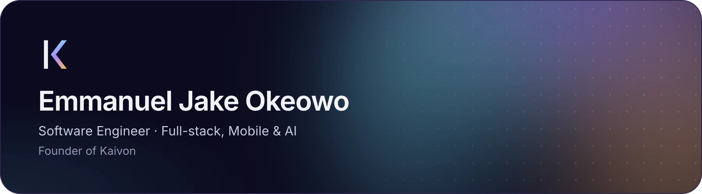
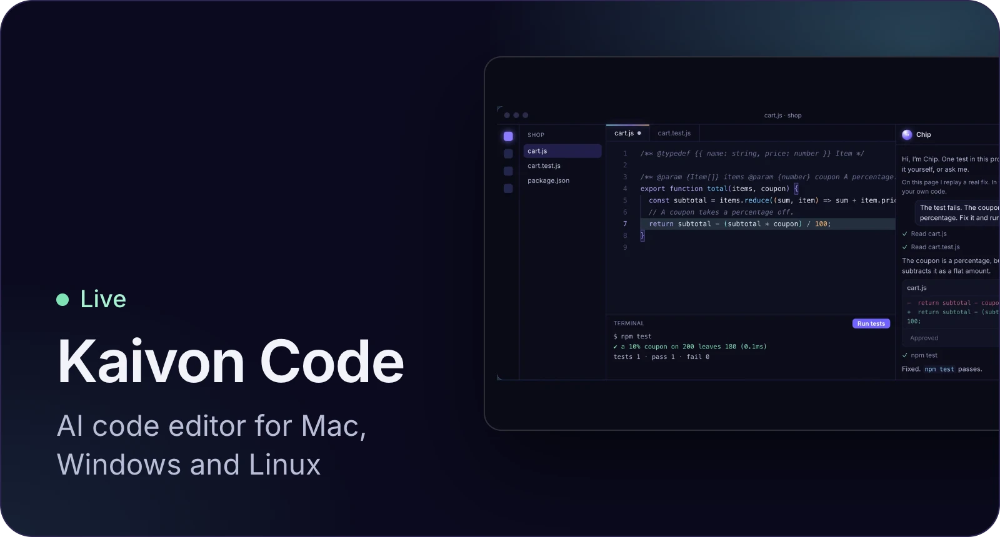
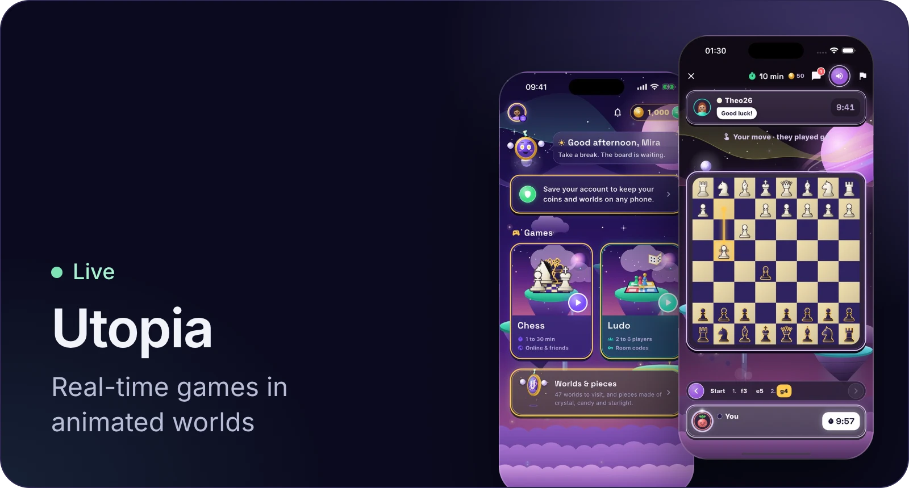
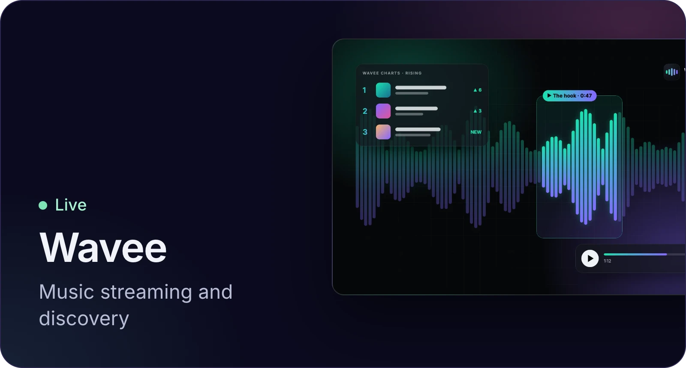
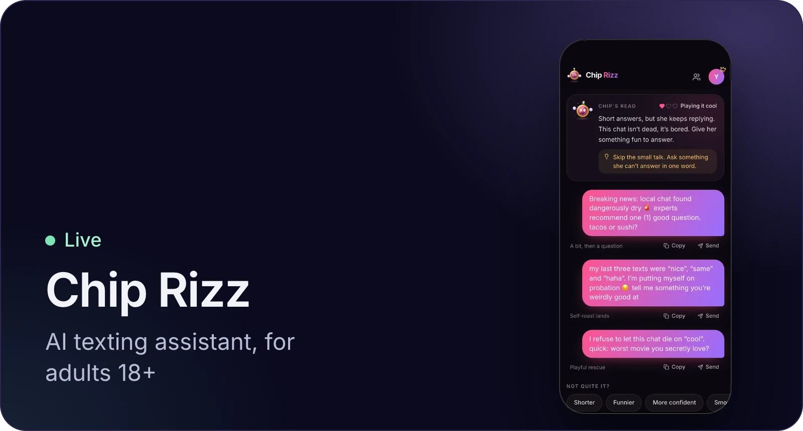
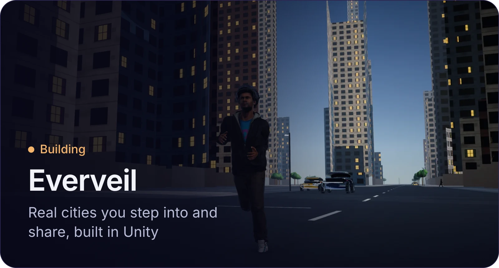

  

  
  
  
  
  
  

  Also building Kaivon ERP, Core, Engine, Blueprint and Twin 
  <a href="mailto:emmanueljakeokeowo@gmail.com">Email</a> · <a href="https://emmanuel-jake-okeowo.onrender.com">Portfolio</a>

